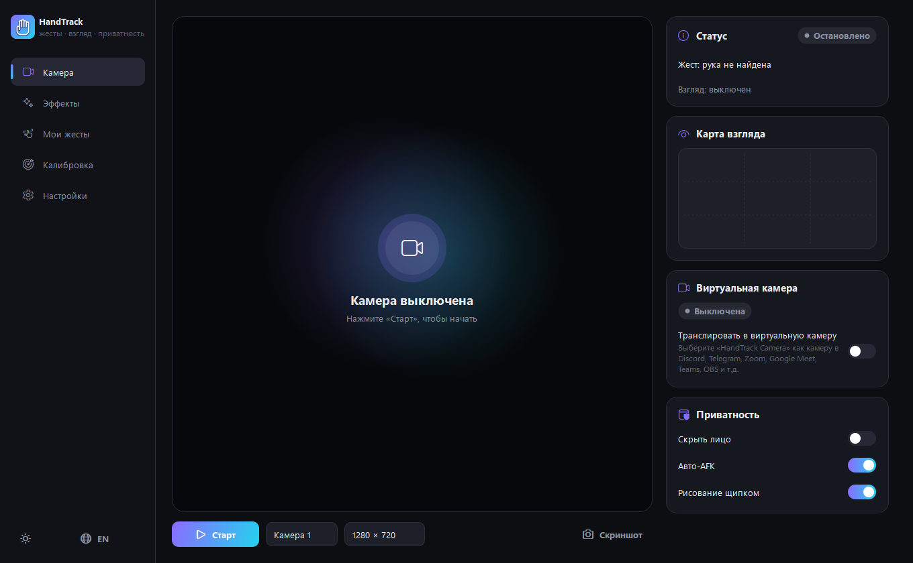
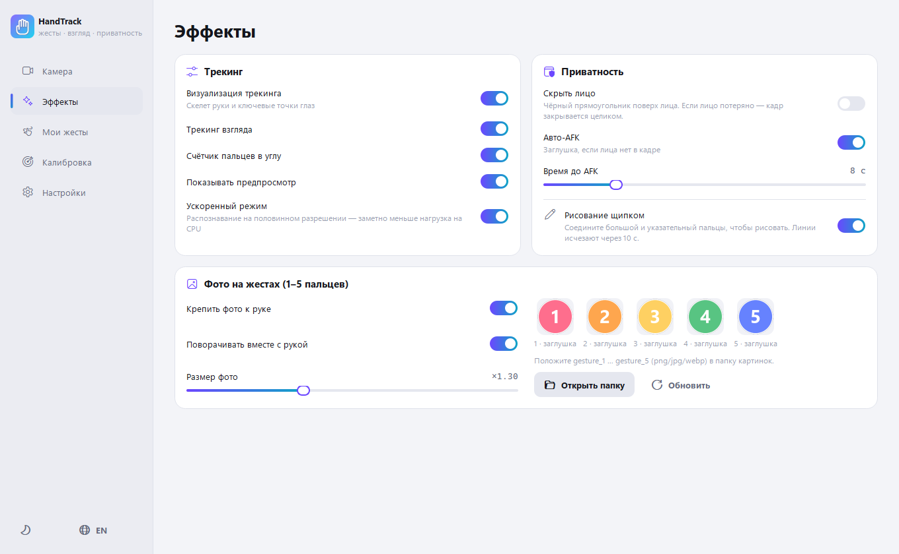

<div align="center">


# HandTrack

**Жесты, взгляд и приватность для видеозвонков.**
Виртуальная камера для Discord, Telegram, Zoom, Google Meet, Teams, Skype и OBS — без установки OBS.

[Скачать установщик](../../releases/latest) · [English](#english)



</div>

## Возможности

- **Виртуальная камера «HandTrack Camera»** — появляется в списке камер любого приложения,
  которое работает с веб-камерами. Драйвер ставится вместе с программой, OBS не нужен.
  Разрешение подстраивается автоматически, картинка никогда не растягивается.
- **Свои жесты** — соберите комбинацию из пяти пальцев и привяжите к ней действие:
  горячие клавиши, медиа-кнопки, громкость, запуск программы, открытие ссылки, скриншот,
  скрытие лица.
- **Приватность** — чёрная маска поверх лица (если трекинг потерян, кадр закрывается целиком)
  и авто-AFK, когда вы отходите от камеры.
- **Фото на жестах** — покажите 1–5 пальцев, и к руке «прикрепится» ваша картинка.
- **Рисование щипком** — сведите большой и указательный пальцы и рисуйте в воздухе.
- **Трекинг взгляда** с калибровкой по 9 точкам.
- **Калибровка жестов** 1–5 под вашу руку.
- Тёмная и светлая темы, русский и английский интерфейс, плавные анимации.

<table>
<tr>
<td></td>
<td></td>
</tr>
</table>

## Установка

1. Скачайте `HandTrack-Setup-x.y.z.exe` со страницы [Releases](../../releases/latest).
2. Запустите и оставьте галочку «Установить драйвер виртуальной камеры».
3. Откройте HandTrack → **Старт** → включите **Транслировать в виртуальную камеру**.
4. В Discord / Telegram / Zoom выберите камеру **HandTrack Camera**.

> Если приложение для звонков было открыто во время установки, перезапустите его, чтобы
> оно увидело новую камеру.

### Совместимость

Камера регистрируется как DirectShow-устройство (64- и 32-битное), поэтому работает в
Discord, Telegram Desktop, Zoom, Skype, Microsoft Teams, Chrome / Edge / Firefox
(Google Meet, веб-версии мессенджеров) и OBS. Не появится только в приложениях, которые
используют исключительно Media Foundation — например, во встроенном приложении «Камера» Windows.

## Запуск из исходников

Нужен Python 3.10–3.12 (3.13+ тоже работает, если для него есть сборка mediapipe).

```bash
python -m venv .venv
.venv\Scripts\activate
pip install -r requirements.txt
python -m handtrack
```

Модели MediaPipe (~11 МБ) скачаются при первом запуске. Драйвер виртуальной камеры при
запуске из исходников: выполните `python packaging/fetch_deps.py`, затем в программе
**Настройки → Установить драйвер** (попросит права администратора). Другой вариант —
`pip install pyvirtualcam` и OBS Virtual Camera.

### Сборка установщика

```powershell
pip install -r requirements-dev.txt
winget install JRSoftware.InnoSetup
powershell -ExecutionPolicy Bypass -File packaging\build.ps1
```

Результат — `dist\HandTrack-Setup-<версия>.exe`. Скрипт сам скачает модели и драйвер
Unity Capture (закреплён на конкретном коммите и проверяется по SHA-256).

GitHub Actions собирает установщик на каждый push, а при пуше тега `v*` публикует релиз:

```bash
git tag v7.0.0 && git push origin v7.0.0
```

### Тесты

```bash
pip install -r requirements-dev.txt
python -m pytest
```

## Как это устроено

```
handtrack/
├── app.py            запуск: сплэш → модели → главное окно
├── engine.py         видеоконвейер в отдельном потоке
├── vcam.py           вывод в виртуальную камеру (протокол Unity Capture)
├── actions.py        действия жестов: клавиши, медиа, программы
├── config.py         настройки, калибровки, жесты (атомарная запись JSON)
├── i18n.py           строки RU / EN
├── vision/           геометрия руки и глаз, отрисовка, загрузка моделей
└── ui/               PySide6: тема, анимированные виджеты, страницы
```

Интерфейс никогда не ждёт камеру или нейросети. Захват идёт в своём потоке и хранит только
последний кадр. Обработка и наложения работают в потоке движка, MediaPipe распознаёт
асинхронно, а вывод в камеру выполняется в третьем потоке. Кадр от камеры до превью и до
виртуальной камеры не конвертируется в RGB: Qt и драйвер принимают BGR. Стикеры
накладываются целочисленным премультиплицированным блендингом. Пока окно превью не видно,
кадры для него не готовятся; пока виртуальную камеру никто не смотрит, кадры в неё
отправляются с частотой 2 FPS.

Данные пользователя (настройки, калибровки, картинки для жестов, логи) хранятся в
`%APPDATA%\HandTrack` у установленной версии и рядом с кодом при запуске из исходников.

## Лицензия

[MIT](LICENSE). Установщик включает сторонние компоненты со своими лицензиями, см.
[THIRD_PARTY_NOTICES.md](THIRD_PARTY_NOTICES.md).

---

<a id="english"></a>

## English

HandTrack is a desktop app for video calls. It recognises hand gestures, tracks gaze, hides
your face on request and streams the processed picture to a virtual webcam called
**HandTrack Camera**. The camera works in Discord, Telegram Desktop, Zoom, Teams, Skype,
browsers and OBS. The installer ships and registers its own driver (Unity Capture), so
OBS is not required.

**Install:** download `HandTrack-Setup-x.y.z.exe` from [Releases](../../releases/latest),
keep "Install the virtual camera driver" checked, then press **Start** and enable
**Stream to virtual camera**. Pick *HandTrack Camera* in your call app.

**From source:** `pip install -r requirements.txt && python -m handtrack`.

**Build the installer:** `powershell -File packaging\build.ps1` (needs Inno Setup 6).
