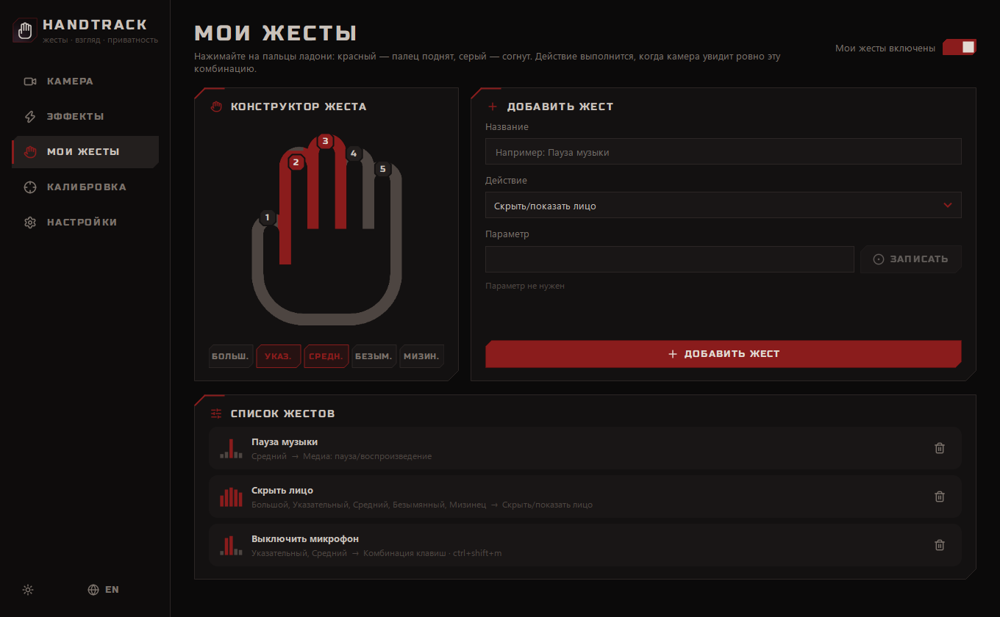

<div align="center">


# HANDTRACK — Windows

**Жесты, взгляд, скрытие лица и рисование в воздухе — прямо в ваших звонках.**
Своя виртуальная камера для Discord, Telegram, Zoom, Google Meet, Teams, Skype и OBS. Без OBS.

*In collaboration with [Claude](https://claude.ai).*

[⬇ Скачать](../../releases/latest) · [Пошаговая установка](HOW-TO-INSTALL.txt) · [Linux](https://github.com/OWNER/HandTrackLinux) · [macOS](https://github.com/OWNER/HandTrackMac) · [English](#english)


</div>

## Установка за минуту

1. [Releases](../../releases/latest) → скачайте **HandTrack-windows.zip** и распакуйте.
2. Дважды щёлкните **Install HandTrack.bat**. На синем окне SmartScreen: «Подробнее» → «Выполнить в любом случае»; на запрос Windows: «Да».
3. HandTrack появится в меню «Пуск». В звонке выберите камеру **HandTrack Camera**.

Подробно, с картинками ошибок и решениями — в [HOW-TO-INSTALL.txt](HOW-TO-INSTALL.txt).
Удаление — **Uninstall HandTrack.bat**, «Пуск → Uninstall HandTrack» или «Параметры → Приложения».

> Можно скачать и просто код (Code → Download ZIP): тот же установщик сам поставит
> изолированный Python 3.12 и все библиотеки в папку программы — ничего не нужно ставить вручную.

## Что умеет

- **HandTrack Camera** — своя виртуальная камера (драйвер ставится вместе с программой). Разрешение подстраивается само, картинка не растягивается. Пока камеру никто не смотрит, кадры почти не отправляются — CPU отдыхает.
- **Скрыть лицо** — чёрная маска с красным щитом; при потере лица закрывается весь кадр. В программе в это время пульсирует значок **COVERING**.
- **Рисование щипком** — линии с плавным исчезновением, сглаживанием дрожи, выбором цвета, толщины и времени жизни; очистка кнопкой или жестом.
- **Мои жесты** — любая комбинация пальцев → горячие клавиши, медиа, громкость, программы, ссылки, скриншот, скрытие лица, очистка рисунка.
- **Фото на жестах** — покажите 1–5 пальцев, и к руке «прилипнет» ваша картинка.
- **Трекинг взгляда** с калибровкой по 9 точкам, **авто-AFK**, калибровка жестов под вашу руку.
- Тёмная и светлая темы, русский и английский.

<table><tr>
<td></td>
<td></td>
</tr></table>

## Устройство репозитория

```
Install HandTrack.bat     установщик (единственное, что нужно запускать)
Uninstall HandTrack.bat   деинсталлятор
HOW-TO-INSTALL.txt        пошаговая инструкция
src/handtrack/            программа: engine, vision, vcam, ui, …
packaging/                сборка: windows/, общая спецификация PyInstaller, загрузка моделей и драйвера
tests/                    тесты (python -m pytest)
docs/                     скриншоты, сторонние лицензии
```

Linux- и macOS-версии лежат в своих репозиториях с тем же кодом и своими установщиками.

### Разработка

```powershell
python -m venv .venv; .venv\Scripts\activate
pip install -r packaging\requirements-dev.txt
$env:PYTHONPATH = "src"; python -m handtrack        # запуск
python -m pytest                                    # тесты
powershell -ExecutionPolicy Bypass -File packaging\windows\build.ps1   # релиз dist\HandTrack-windows.zip
```

GitHub Actions собирает и проверяет релиз на каждый push; тег `v*` публикует его в Releases.

## Производительность

Обработка идёт в отдельном потоке, нейросети — асинхронно, интерфейс никогда не ждёт камеру.
Кадр не конвертируется для превью и камеры (Qt и драйвер берут BGR напрямую), стикеры
смешиваются целочисленно, неоновое свечение размывается в ¼ разрешения (рисунок на весь
кадр: 3 мс вместо 47), превью не готовится, пока его не видно.

## Лицензия

[MIT](LICENSE). Сторонние компоненты — [docs/THIRD_PARTY_NOTICES.md](docs/THIRD_PARTY_NOTICES.md).

---

<a id="english"></a>

## English

HandTrack recognises hand gestures, tracks gaze, hides your face and lets you draw neon lines in
the air, then streams the result to its own **HandTrack Camera** for Discord, Telegram, Zoom,
Meet, Teams, Skype and OBS — no OBS needed.

**Install:** download **HandTrack-windows.zip** from [Releases](../../releases/latest), unzip, double-click
**Install HandTrack.bat** (SmartScreen: "More info" → "Run anyway"; Windows prompt: "Yes").
Pick **HandTrack Camera** in your call app. Remove it with **Uninstall HandTrack.bat**.
Step by step: [HOW-TO-INSTALL.txt](HOW-TO-INSTALL.txt).
