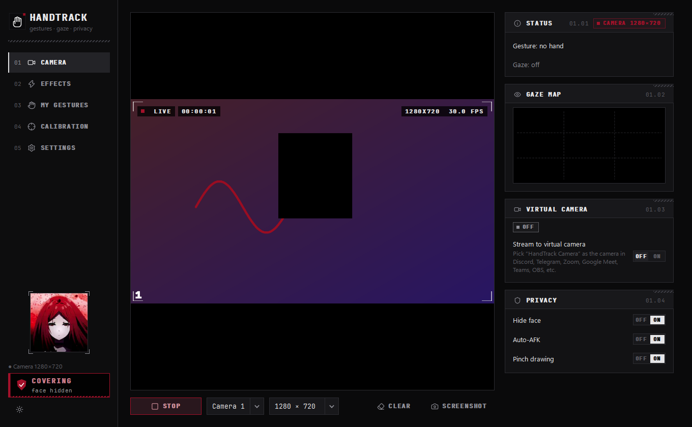
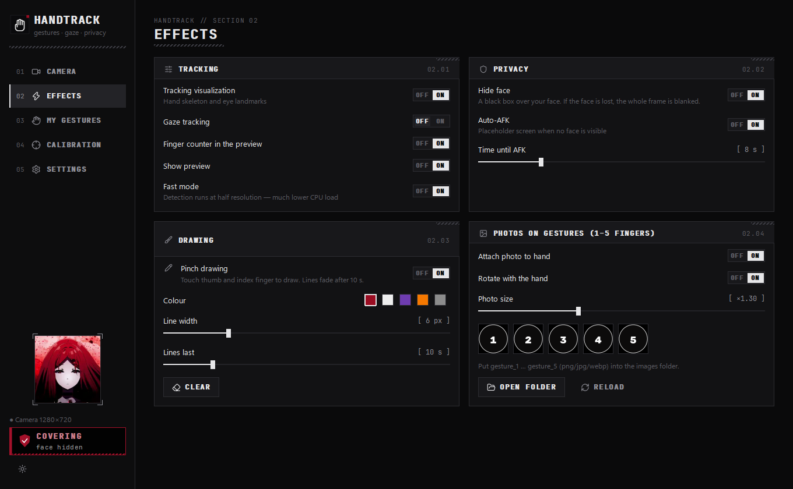

<div align="center">


# HANDTRACK — Windows

**Gestures, gaze, face hiding and drawing in the air, right inside your calls.**
Its own virtual camera for Discord, Telegram, Zoom, Google Meet, Teams, Skype and OBS. No OBS needed.

*In collaboration with [Claude](https://claude.ai).*

[⬇ Download](../../releases/latest) · [Step-by-step install](HOW-TO-INSTALL.txt) · [Linux](https://github.com/wizzard111/HandTrackLinux) · [macOS](https://github.com/wizzard111/HandTrackMac)



</div>

## Install in a minute

1. [Releases](../../releases/latest) → download **HandTrack-windows.zip** and unzip it.
2. Double-click **Install HandTrack.bat**. On the blue SmartScreen window: "More info" → "Run anyway"; on the Windows prompt: "Yes".
3. HandTrack appears in the Start menu. In your call, pick the camera **HandTrack Camera**.

The full walkthrough, with common problems and fixes, is in [HOW-TO-INSTALL.txt](HOW-TO-INSTALL.txt).
Uninstall with **Uninstall HandTrack.bat**, "Start → Uninstall HandTrack" or "Settings → Apps".
Running the installer again only adds what is missing or changed.

> You can also download just the code (Code → Download ZIP): the same installer sets up an
> isolated Python 3.12 and all libraries inside the program folder. Nothing to install by hand.

## Features

- **HandTrack Camera**: its own virtual camera (the driver is installed with the app). The resolution adapts by itself and the picture is never stretched. While nobody watches the camera, almost no frames are sent, so the CPU rests.
- **Hide face**: a plain black square over your face; if the face is lost, the whole frame is covered. A sound plays when it switches on, and a **COVERING** badge shows meanwhile.
- **Pinch drawing**: lines that fade out smoothly, with jitter smoothing and a choice of colour, thickness and lifetime; clear them with a button or a gesture.
- **My gestures**: any finger combination → hotkeys, media, volume, programs, links, a screenshot, face hiding, clearing the drawing.
- **Photos on gestures**: show 1–5 fingers and your picture "sticks" to your hand.
- **Gaze tracking** with 9-point calibration, **auto-AFK**, gesture calibration for your hand.
- **Hotkey** for Hide face that works in any program (default Ctrl + Alt + H, rebindable in Settings).
- Runs in the **tray**: closing the window keeps the camera and the call stream going; quick controls in the tray menu. Starting it again just brings the running window back.
- **Log window** with the live log at startup (can be turned off), for when something needs explaining.
- Dark and light themes.

<table><tr>
<td></td>
<td></td>
</tr></table>

## Repository layout

```
Install HandTrack.bat     the installer (the only thing you need to run)
Uninstall HandTrack.bat   the uninstaller
HOW-TO-INSTALL.txt        step-by-step guide
src/handtrack/            the program: engine, vision, vcam, ui, …
packaging/                build: windows/, shared PyInstaller spec, model and driver download
tests/                    tests (python -m pytest)
docs/                     screenshots, third-party licenses
```

The Linux and macOS versions live in their own repositories with the same code and their own installers.

### Development

```powershell
python -m venv .venv; .venv\Scripts\activate
pip install uv; uv pip install -r packaging\requirements-dev.txt --override packaging\overrides.txt
$env:PYTHONPATH = "src"; python -m handtrack        # run
python -m pytest                                    # tests
powershell -ExecutionPolicy Bypass -File packaging\windows\build.ps1   # release dist\HandTrack-windows.zip
```

GitHub Actions builds and checks the release on every push; a `v*` tag publishes it to Releases.

## Performance

Measured with [`packaging/benchmark.py`](packaging/benchmark.py): the real app runs each situation for
20 s in a fresh process while the script samples its CPU and memory once a second. To compare
operating systems on equal terms, a 1280×720 video at 30 FPS (an empty room, so hand and face
detection keep searching: the costly case) stands in for the webcam.

Machine: AMD Ryzen 5 5600X (6 cores, 12 threads), 16 GB RAM. HandTrack 8.2.0, Python 3.12.
CPU is in % of **one** core, summed over all of the app's threads; divide by 12 for the share of the
whole processor. RAM is the resident set (working set on Windows; includes shared libraries), USS is
memory used by HandTrack alone.

| Situation | Windows 11: CPU | RAM | USS | Linux (Debian 13): CPU | RAM | USS |
|---|---:|---:|---:|---:|---:|---:|
| Window open, camera off | 2.1 % | 202 MB | 136 MB | 0.9 % | 241 MB | 227 MB |
| In the tray, camera off | 1.4 % | 202 MB | 135 MB | — | — | — |
| Camera on | 36 % | 234 MB | 162 MB | 30 % | 288 MB | 274 MB |
| Camera on, window in the tray | 25 % | 233 MB | 164 MB | — | — | — |
| Camera on + Hide face | 35 % | 232 MB | 160 MB | 29 % | 285 MB | 271 MB |
| In a call: Hide face + virtual camera, read by a call app | 39 % | 244 MB | 169 MB | — | — | — |

With the real webcam (Windows, Lenovo FHD webcam, 1280×720 at ~30 FPS) the numbers depend on what is
in view: 55–85 % of one core (5–7 % of the whole processor), 250–280 MB RAM. Reading the camera
itself costs about 13 % of a core at 1280×720 and 30 % at 1920×1080 (the MJPG decoding in Windows'
DirectShow), so 1280×720, the default, is the economical choice; most call apps send 1280×720 anyway.
The camera starts in about 0.6 s.
Linux was measured under WSL2 (WSLg); "—" means the situation needs a tray or the Windows camera
driver, which WSL lacks. macOS has not been measured.

How it stays light:

- Idle costs almost nothing: no timers repaint the window; the preview, status tags and gaze map
  redraw only when something changes. Before 8.2 an idle window took 11 % of a core. The small
  sidebar animation (about 1 % of a core, 15 FPS) pauses while the window is minimised or in the
  tray, and can be switched off in Settings.
- Detection slows down while nothing is in view (hands 15, faces 10 checks a second) and returns to
  full rate the moment a hand or face appears. Processing runs on its own thread, the neural
  networks asynchronously; the interface never waits for the camera.
- The camera format is set once when it opens (DirectShow rebuilt its capture graph for every
  setting: the first frame came after 2.2 s, now after 0.6 s).
- Every frame is processed once: the AFK screen is rendered once and copied, the preview is
  converted to Qt's native format on the video thread and is not prepared while hidden, stickers
  are blended with integer maths, and the drawing goes straight into the frame.
- No idle thread pools: OpenCV runs single-threaded and numpy's OpenBLAS uses one thread (its
  per-core buffers alone were ~350 MB of private memory).
- Only what is needed is installed: the headless OpenCV, without mediapipe's GUI OpenCV,
  matplotlib and audio packages. The face-hiding sound is played by the operating system, with no
  audio library in the app.

Reproduce: `PYTHONPATH=src python packaging/benchmark.py --video any-video.mp4`
(or `--video camera` for the webcam).

## License

[MIT](LICENSE). Third-party components: [docs/THIRD_PARTY_NOTICES.md](docs/THIRD_PARTY_NOTICES.md).
